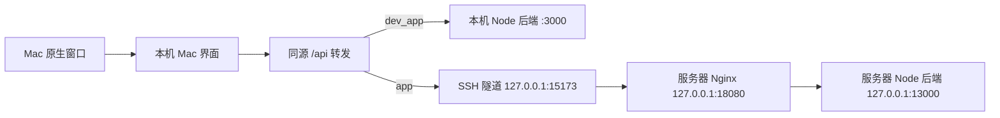

# macOS 桌面版执行计划

编制日期：2026-11-06（Asia/Singapore）。

状态：需求与代码调查完成，等待进入实施阶段。本文件是执行计划，不代表桌面端或 Make 命令已经实现。本轮只写计划、只读检查服务器，没有启动应用、修改后端、开放端口或部署服务。

## 1. 目标与范围

在 `desktop_mac/` 实现 macOS 桌面版，窗口、导航、页面布局、颜色、字体和操作体验以 `/Users/likai/go/src/write/wukong` 为参照。桌面版承载本项目的小说创作能力，支持从 AI 规划、正文生产到全书导出的完整流程。

根目录提供六个命令：

| 命令 | 用户得到的结果 |
| --- | --- |
| `make dev_app` | 启动 Mac 桌面版，连接本机后端，用于开发测试 |
| `make app` | 启动 Mac 桌面版，连接指定服务器上的后端 |
| `make stop_app` | 关闭本项目桌面程序及其自有本机辅助进程 |
| `make restart_app` | 按最近一次请求的模式重新构建并启动桌面程序 |
| `make up_app` | 更新指定服务器上的服务版本，重启后端并检查可用性 |
| `make list` | 列出可用 Make 命令、用途和必要配置 |

实施边界：

- Mac 新增源码、样式、原生桥接、启动与部署编排集中在 `desktop_mac/`。
- 不修改 `server/` 业务代码、数据库结构、Prompt、AI 决策、任务恢复规则或现有 API 合同。
- 可调整根目录 Makefile、工作区配置及必要的前端复用入口；这些改动不得改变原 Web 和 Windows 桌面版的默认行为。
- 复用后端和前端业务能力；不将 wukong 的 Go、Python Agent、PostgreSQL 或业务 API 移植进来。
- 样式一致覆盖实际业务页面，而不止窗口边框、首页或侧栏。最终验收前必须覆盖所有向用户开放的页面入口。
- 本阶段交付可从源码启动的 `.app`。公开 DMG、签名、公证和 GitHub Releases 上传不属于六个命令的必要范围，后续需要时单独安排。

## 2. 已核实的项目现状

### 2.1 本项目

| 检查项 | 当前事实 | 实施影响 |
| --- | --- | --- |
| 本地版本 | 当前为 `ai`，提交 `09c9db63`；调查开始时仅有空的未跟踪 `mac.md` | 文档可独立提交；功能实施另建分支 |
| 前端 | React 19、TypeScript、Vite、Tailwind、项目自有 UI primitives | 沿用现有依赖和业务组件，不另装 shadcn 组件 |
| 现有桌面端 | `desktop/` 为 Electron，包说明为 Windows runtime，版本 `0.6.1` | Mac 独立实现，不改写 Windows 启动、迁移与更新路径 |
| 桌面旧行为 | 现有 Electron 主进程管理本地 Node 服务和桌面数据 | 不能直接套用到连接服务器的 Mac 模式 |
| API 入口 | `client/src/api/client.ts`、`client/src/lib/constants.ts` 已集中管理 API 地址 | 复用请求、错误、超时机制，避免每页拼接服务器地址 |
| 页面路由 | `client/src/router/index.tsx` 集中列出业务路由，当前固定使用 `AppLayout` | 提供可注入布局的稳定入口，Mac 使用独立外壳 |
| 服务器运维 | 已有 `infra/server/`、根目录 `start.sh` / `stop.sh` / `restart.sh` | 使用现有部署边界，不复制另一套服务管理规则 |
| Make | 当前版本控制中没有根目录 Makefile / GNUmakefile | 新增薄 Makefile，具体行为交给模块脚本 |

### 2.2 wukong 参考基线

以下信息来自本地源码和文档检查，尚未进行窗口或截图验收：

| 参考位置（相对 wukong 根目录） | 应参考的内容 |
| --- | --- |
| `docs/main.md`、`docs/desktop-runtime.md` | 工程入口、桌面运行模式、窗口恢复与输入保留 |
| `desktop/WukongPrototypeApp.swift` | Swift / AppKit / WKWebView，原生窗口及菜单 |
| `web/src/styles/base.css` | 基础颜色、字体、三栏结构、写作字号 |
| `web/src/styles/app.css` | 64px 图标栏、40px 顶栏、按钮尺寸、列表和画布层次 |
| `web/src/components/layout/NavigationSidebar.jsx` | 图标导航、书籍选择、tooltip、选中状态与计数 |
| `GNUmakefile`、`scripts/app_mode.sh` | 命令入口、请求模式与成功模式、先构建再切换 |

wukong 的 `make app` 仍在 Mac 本地运行其业务后端，通过 SSH 连接服务器数据库；本项目的 `make app` 必须连接服务器上的完整 Node 后端，不能照搬这一拓扑。wukong 使用 `re_app`，未发现 `restart_app` 和 `up_app`；本项目按用户要求实现后两个名称。

### 2.3 服务器只读检查结论

目标：`root@152.136.155.200`，目录 `/data/write/AI-Novel-Writing-Assistant`。

| 检查项 | 2026-11-06 的结果 |
| --- | --- |
| 部署分支 / 提交 | `ai` / `eaa4bd8f`，工作区无已显示的修改 |
| API 监听 | `127.0.0.1:13000` |
| Nginx 监听 | `127.0.0.1:18080` |
| 代理规则 | `/api/` 原路径转发到 `13000`，关闭代理缓冲，读写超时 3600 秒 |
| 进程管理 | `ai-novel-api.service`、`ai-novel-web.service` 均 active/running，运行账户为 `ai-novel` |
| API 健康 | `http://127.0.0.1:13000/api/health` 返回成功、`status=ok` |
| 代理健康 | `http://127.0.0.1:18080/api/health` 返回成功、`status=ok` |
| 数据读取 | 代理后的 `/api/novels?page=1&pageSize=1` 返回 HTTP 200；未输出小说内容 |
| 网络配置 | `HOST=127.0.0.1`、`ALLOW_LAN=false`，CORS 配置包含本机 `15173` 入口 |

结论：后端接口已经存在，Nginx 映射也存在，但仅在服务器本机开放。Mac 应通过 SSH 本地转发使用它，无需修改后端或开放公网业务端口。

原因不是推测：`server/src/middleware/auth.ts` 当前直接 `next()`；`docs/wiki/architecture/server-deployment.md` 明确将 SSH 作为个人部署的访问边界。直接将端口绑定到 `0.0.0.0` 会公开可修改小说、模型设置和任务的接口，不作为本计划的接入方案。

上述检查证明服务器内部 API 和数据库读取可用，不等于已验证 Mac 隧道、WKWebView、AI 流式生成或导出。实施时重新核对部署状态。

## 3. 技术方案与目录职责

### 3.1 原生壳和独立界面

采用 **Swift / AppKit / WKWebView + React / TypeScript / Vite**。原生壳与 wukong 保持一致；前端复用本项目已安装的技术栈与业务能力。

- Swift 负责窗口、菜单、应用生命周期、文件选择和保存，以及最小化的原生桥接。
- React 负责 wukong 风格的工作台与创作页面。
- 本机辅助服务只提供静态资源和 API 转发，不包含业务规则、数据库访问、LLM 调用或任务调度，因此不构成新业务后端。
- 正式模式加载本机构建的 Mac 界面，再经隧道调用远端 API；不能直接显示服务器现有 Web 首页来替代 Mac 样式实现。
- 不加载现有 `client/src/main.tsx` 的 Electron 启动边界；Mac 自行组合 React Query、主题、路由与连接状态。平台能力显式传入，不伪造 Windows 更新、数据库导入或本地引擎状态。

建议目录（实施时可在职责不变的前提下细化）：

```text
Makefile
desktop_mac/
  README.md
  package.json
  config/
    app.example.json             # 本机端口、SSH 目标、部署 ref 的示例，不含密钥
  native/
    Sources/
      App/                       # AppDelegate、菜单、单实例与退出
      Window/                    # 窗口状态、显示恢复、WKWebView
      Bridge/                    # 导航白名单、文件选择与保存
    Resources/                   # Info.plist、图标
  renderer/
    index.html
    vite.config.ts
    src/
      app/                       # 启动、provider、运行环境、路由装配
      shell/                     # 导航、顶栏、目录栏、工作画布
      theme/                     # token、样式作用域、字体许可
      features/                  # 小说、导演、编辑器、运行记录等视图适配
      platform/                  # Mac 原生桥接适配
  application/
    lifecycle/                   # 模式、启动、关闭、重启、健康检查
    deployment/                  # 部署计划、备份、构建、切换、回滚
  infrastructure/
    processes/                   # launchd、进程归属、锁、日志
    transport/                   # loopback 静态服务、API 代理、SSH 通道适配
  scripts/                       # Make 调用的薄入口
  tests/                         # 生命周期、传输和部署的针对性测试
```

运行记录与构建产物进入忽略目录 `.runtime/desktop_mac/`，日志进入 `.logs/desktop_mac/`。开发和服务器模式分别保存端口、缓存、窗口/页面状态与进程元数据，防止串用数据。

外部复用入口通过模块 facade 暴露；不不断增加对其他模块内部文件的深层引用。新增单文件超过 1,300 行必须先拆分，目录和模块遵守项目现有职责边界规则。

### 3.2 前端复用边界

1. 为现有路由提供可注入 layout 的构建函数或等价 facade，Web 默认仍使用原 `AppLayout`，Mac 传入 `MacAppLayout`。
2. 将布局中的必要业务 provider、模型初始化、任务提醒和恢复上下文整理为无视觉依赖的复用入口。替换导航不能丢失这些行为。
3. 复用现有 API、类型、查询缓存、业务 hooks 和编辑器能力；Mac 页面容器与视图适配放在 `desktop_mac/renderer/src/features/`。
4. 对混合业务与视觉的页面，先提取最小稳定复用边界，再构建 Mac 视图。不得整份复制所有前端形成两套业务逻辑。
5. 样式限定在 Mac 根节点或独立构建入口；映射现有语义 CSS 变量，不对 Web 全局改色，不用跨全站的 `!important` 覆盖堆叠。
6. 保留现有 source route、查询参数和功能开关。运行记录跳回小说、章节或导演工作台时必须定位正确对象。

### 3.3 两种连接链路



拟定默认端口：开发界面 `15174`、正式界面 `15175`、远端隧道 `15173`、本机 API `3000`。这些是计划值，实施前检查占用并允许显式覆盖；端口冲突报出归属，不杀占用进程，不暗中换到另一套数据。

- `dev_app` 使用 Vite 和本机 API；API 已经运行且归属明确时复用，否则由本命令启动现有后端开发入口，并记录所有权。
- `app` 使用构建后的静态资源与固定目标代理，不启动本机业务后端；复用 `infra/server/tunnel.sh` 的连接能力，补齐目标、端口、进程归属与创建者校验。
- 原生 WebView 只加载配置的 loopback 页面；外部链接由系统浏览器打开。脚本桥接只接受可信页面和明确动作，禁止传任意 shell 命令。
- 统一使用相对 `/api`，使 axios、fetch/SSE、上传、图片和导出共用同一连接；辅助服务须支持 SPA 深链接回退，刷新不会返回 404。
- API 转发保留状态码、请求体、必要请求头与响应头，流式响应逐块转发、支持取消，不整体缓存，不使用短超时截断 AI 输出。断线不自动重放生成或保存请求。
- 文件上传、Blob 下载、`Content-Disposition`、本地图片地址和 SSE 在早期兼容性阶段逐项验证。下载通过 WKWebView / 原生保存对话框适配，不改后端合同。
- 切换模式采用完整的应用重启，重新创建查询缓存并隔离草稿存储；不在编辑中静默切换 API。界面持续显示“本地测试”或“服务器”。
- 保留 SSH 主机校验，使用系统 SSH 身份，不把私钥或服务器密钥写入应用、Git、命令日志或示例配置。

## 4. wukong 样式和操作验收基线

### 4.1 视觉规格

| 部分 | 基线 |
| --- | --- |
| 窗口 | 默认 1440×900，可缩放，隐藏标题文字、透明原生标题栏、标准红黄绿按钮、保存窗口位置 |
| 缩窄策略 | 先折叠目录和辅助面板，保留主要操作；wukong 最小窗口为 390×600，Mac 适配阶段验证后采用，不直接套用旧 Web 布局 |
| 导航 | 固定 64px 图标栏，当前页面灰底选中，hover/focus tooltip，计数 badge |
| 顶栏 | 40px，轻量标题、当前位置和当前页面操作，与原生标题区域协调 |
| 次级列表 | 默认 244px，可折叠；书籍列表、卷章目录或页面内部索引按上下文使用 |
| 按钮 | 主要导航按钮 32×32px、6px 圆角、16px 图标；导航间距 3px |
| 主背景 | `#fafafa` |
| 侧栏 / 面板 | `#eeeeee` / `#e9e9e9` |
| 列表底色 / 轻内容底色 | `#f4f4f2` / `#f7f7f7` |
| 正文 / 次级文字 | `#242424` / `#878787` |
| 分隔线 | `#d8d8d8`，仅用于必要分区 |
| hover / 选中 | `#dddddd` / `#c6c6c6` |
| 强调 / 文本选择 / 危险 | `#2999bf` / `#0a84ff` / `#b84e47` |
| UI 字体 | macOS 系统无衬线优先，中文 PingFang，默认 14px |
| 写作正文 | 对齐 wukong 的 LXGW WenKai，默认 20px、1.6 行高；随字体保留 `LXGWWenKai-OFL.txt` |
| 分栏动画 | 参考 180ms，并尊重减少动画的系统偏好 |
| 色彩模式 | 首轮固定 wukong 当前浅色基线；参考源码未提供完整深色主题，不自行设计另一套默认外观 |

原生窗口与页面顶部一起验收，避免标题栏和工具栏重叠。普通内容靠留白、字号、对齐和背景层次分组；不复制参考项目中与本项目低边框规则冲突的常驻阴影、嵌套卡片边框。弹窗、菜单、输入和选中状态保留必要边界。

### 4.2 操作方式

- 常用入口固定位置，新建与书籍选择可快速到达；书内目录位于次级栏，正文使用主要画布。
- 图标栏同时具备 tooltip、可访问名称和键盘焦点；新手主要页面保留“下一步”与清晰默认操作，不能只留下无说明图标。
- 对齐 macOS 的 `⌘Q`、复制粘贴、撤销重做、窗口重开、前进后退；`⌘S` 接入页面已有保存能力，不能另造保存逻辑。
- 重载、退出、重启涉及未保存输入时走页面保存/确认流程；取消后保留当前窗口。命令输出明确需要在窗口处理的情况。
- 参考 wukong 的显示恢复原则：屏幕切换、唤醒先恢复显示，WebView 异常不能无提示重载并丢失正文。
- 顶部连接信息使用简短用户语言；故障提示区分“本机服务未启动”“服务器连接中断”“请求失败”，提供对应下一步。

### 4.3 页面覆盖

| 批次 | 页面范围 | 完成标准 |
| --- | --- | --- |
| 样式样板 | 书架、章节编辑器、设置、运行记录 | 同时覆盖列表、写作画布、表单与记录四类布局，供用户先确认整体风格 |
| 核心创作 | 创建小说、创作中枢、AI 规划、自动导演、小说工作台、章节编辑与预览、导出 | 完整创作链可用，所有状态呈现遵守既有合同 |
| 素材和配置 | 世界、角色、知识库、书籍分析、风格、题材、故事模式、标题、Prompt、模型及系统设置 | 列表、详情、表单、弹层均采用同一视觉规范 |
| 其他现有入口 | 市场雷达、短篇、短剧、漫画、帮助、跟进与用量等启用路由 | 按路由清单逐项完成；不能以旧 Web 页面可打开代替样式验收 |

保留两条产品约束：运行记录只读，仅查看和返回来源页；自动导演的局部质量债务显示为警告，质量优先的人工暂停与必须重规划保持后端原状态。不得因 Mac UI 简化将它们合并成一种失败，也不得在轮询或重连时自动恢复任务。

## 5. Make 命令的行为合同

### 5.1 `make dev_app`

1. 检查 macOS、Xcode Command Line Tools、Node/pnpm、依赖与端口。
2. 使用现有本地后端配置和数据。若配置或数据库未准备好，给出项目现有初始化入口；启动命令不自动迁移、seed、重置或导入服务器数据。
3. 准备 shared 与必要客户端产物；检查本机后端健康和一个数据库读取接口。
4. 复用归属可确认的本机后端；缺少服务时启动并记录本命令所有权。
5. 启动 Vite 与原生 `.app`，记录 requested mode=`local`；全部就绪后记录 running mode。

验收：编辑与生成请求只进入本机后端；重复执行不产生重复进程；不会将测试数据写入服务器。

### 5.2 `make app`

1. 构建或复用未失效的 Mac 静态资源与原生壳；失败保留原运行版本。
2. 检查 SSH 身份、已知主机、隧道目标及本地端口。已有正确隧道可复用，不依赖用户先手工执行映射命令。
3. 检查经隧道的 `/api/health` 与数据库读取接口。
4. 启动本机静态资源/API 代理和 `.app`，请求模式记为 `remote`。

验收：请求到达 `152.136.155.200` 对应部署；本机业务后端关闭时仍可运行；退出终端不导致窗口依赖的辅助服务消失。

### 5.3 `make stop_app`

- 请求原生应用正常退出，处理未保存输入，再停止其自有界面服务与自有本地后端。
- 仅停止本命令创建、且归属校验成功的隧道；复用的共享隧道保留。归属不明时停止操作并报告，不按端口或进程名批量终止。
- 永不停止服务器 `ai-novel-api` / `ai-novel-web`，不影响 wukong 或其他项目。
- 保留小说、草稿、配置、日志和最近请求模式；应用未运行时成功返回。

### 5.4 `make restart_app`

- 按最近请求模式重新构建并重启，区分“请求模式”和“最后成功运行模式”，启动失败后可以重试同一模式。
- 没有历史记录时默认 `remote`，输出说明；可用 `APP_MODE=local` / `APP_MODE=remote` 显式选择。
- 构建与依赖预检在停止原窗口前完成。通过归属校验后只替换本次所需进程；复用的本地后端和共享隧道不无故重启。
- 不部署服务器，也不把重启桌面解释成恢复创作任务。

### 5.5 `make up_app`

作用为部署服务器服务；不负责更新本机 `.app`，也不自动执行 Git 推送、功能分支合并或公开桌面包上传。

默认主机和目录为用户指定值，通过本机忽略配置保存。部署 ref 必须在配置中显式确定并解析成固定提交，不默认使用当前工作区 HEAD。实施前核对现有服务器 `ai` 与 `main` / `beta` 的差异，选定已验证的发布线；不得借部署悄悄切换分支或丢失服务器版本中的功能。新 Mac 功能仍遵循 feature → beta → main。

执行顺序：

1. 获取部署锁，记录旧提交、服务状态、现有数据路径及候选提交；检查服务器工作区、空间和运行中的创作任务。存在活跃生成任务时退出并提示等待，不能主动取消它们。
2. 通过 Git fetch / 明确提交源码包准备候选版本，只传输受控源码。保留 `server/.env`、`data/`、`server/storage/`、`.runtime/` 与日志；禁止删除式 rsync、hard reset 或 clean 覆盖部署目录。
3. 在候选目录或独立构建区安装冻结依赖并构建，复用 `infra/server/README.md` 的 Node/pnpm、shared 注入、SQLite Prisma 生成等流程；不在 Mac 构建 Linux 原生依赖。
4. 备份现有 SQLite 和相关资产、配置。运行中的 SQLite 使用 backup API / `.backup` 一致快照，记录具体备份路径、大小和校验结果，执行 `PRAGMA integrity_check`；资产与配置在发布切换前完成一致性处理。日志不打印密钥。
5. 比较数据库迁移范围。本次 Mac 工作不应引入迁移；如候选版本夹带迁移，停止普通部署，进入已有独立迁移流程。任何破坏性操作必须有明确批准及已验证备份。
6. 候选构建和备份通过后再次检查活跃任务，再切换产物，保持现有 systemd WorkingDirectory 与数据绝对路径有效。复用 `infra/server/control.sh` / 根目录重启入口；需要网页产物同时更新时重启本项目的两项服务。
7. 检查服务器内部 API、Nginx、小说读取，并在可用时检查本机隧道入口。记录部署提交、备份路径、完成时间和健康检查摘要。
8. 健康检查失败时恢复上一套已验证代码/产物并重启，保留失败日志。因为普通流程禁止迁移，代码回滚不得还原或覆盖数据库，避免抹去发布期间的用户写入。

实现 `make up_app DRY_RUN=1`：仅输出目标主机、目录、固定提交、将执行的步骤和检查结果，不传输、不停止、不切换服务。自动测试使用隔离的假 SSH/进程适配器，不以真实服务器部署代替测试。

### 5.6 `make list`

从带说明的 Make 目标生成帮助，至少显示六个命令及 `APP_MODE`、部署目标配置、`DEPLOY_REF` 和 `DRY_RUN=1` 的用法。仅打印信息，不检查 SSH、不构建、不启动服务；无桌面依赖时也能使用。

### 5.7 共同生命周期要求

- 单仓库单活动模式，使用锁防止 start/restart/deploy 并发竞争。
- 进程记录包含仓库绝对路径、角色、PID、启动时间、完整命令标识及模式；发信号前重新校验，防止 PID 复用。
- 后台辅助进程采用当前用户图形会话的 launchd 或同等可靠监督方式，标签区分仓库和模式，支持终端关闭后继续运行。
- 所有启动失败都输出失败阶段、日志位置和重试方式；不把健康接口成功当成整个桌面功能已验收。
- 普通启动、关闭和重启没有数据库维护副作用；持久化数据不进入构建清理列表。

## 6. 分阶段实施与交付

### 阶段 0：基线与实施分支

- [x] 核查现有桌面端、前端入口和服务器运维脚本。
- [x] 核查 wukong 技术栈、样式值和 Make 语义。
- [x] 只读确认服务器端口、健康、数据库读取与 systemd 归属。
- [ ] 开始实施时复核这些事实，记录参考项目提交和当前工作区差异。
- [ ] 创建 `codex/mac-desktop` 功能分支，明确已验证的基线；不在 `main` 或退休的 `desktop-dev` 上展开新功能。
- [ ] 确定部署发布 ref、Mac 最低系统版本、当前机器架构和端口；先支持用户当前机器，不能在未验证时声称兼容全部 Intel / Apple Silicon Mac。

交付：基线清单、页面覆盖清单、配置示例。退出条件：本地与服务器模式的目标和数据边界均明确。

### 阶段 1：原生壳与连接兼容性

- [ ] 建立 `desktop_mac` 工作区、Swift 壳、React 入口及最小 Make 启动链。
- [ ] 建立同源 API 代理、SSH 隧道适配及本地/服务器模式隔离。
- [ ] 打通健康检查、小说读取、现有 SSE 消费、上传/下载适配和路由回跳。
- [ ] 提供原生保存、外部链接、退出与重载保护的必要桥接。

交付：两种模式可启动的最小桌面版。退出条件：Swift 编译、前端类型/构建和传输针对性测试通过；WebKit 编辑与流式表现列入用户验收。若发现现有浏览器组件不兼容，先在 Mac 前端适配，不扩大为后端改造。

### 阶段 2：wukong 风格外壳与样式样板

- [ ] 落地颜色、字体、窗口、图标导航、顶栏、列表栏和工作画布。
- [ ] 完成书架、章节编辑器、设置、运行记录四类样板。
- [ ] 对照第 4 节逐项核对源码值，清除重复边框与页面开发说明文案。
- [ ] 提供用户手动验收步骤，先确认整体风格再扩展全部页面。

交付：可操作的统一样式样板。退出条件：代码检查通过，用户完成关键风格验收；未完成时记录为验收缺口，不宣称“与 wukong 一样”已经通过。

### 阶段 3：完整小说创作链

- [ ] 创建小说、创作中枢、AI 规划、自动导演、小说工作台和章节编辑依次接入 Mac 布局。
- [ ] 补齐卷章切换、保存、AI 流式生成、预览与导出。
- [ ] 保留任务来源导航、暂停状态、质量债务、显式恢复和书级投影。
- [ ] 检查断线、切换模式、窗口恢复与未保存输入的处理。

交付：本地与服务器各自可完成一轮创建到导出的流程。退出条件：复用的合同测试与必要新增回归通过；真实 AI 与 UI 操作由用户使用测试小说验收，不批量修改生产小说。

### 阶段 4：其余页面与交互一致性

- [ ] 按路由清单完成素材、配置、分析及其他启用模块。
- [ ] 统一表单、空状态、错误状态、加载、弹窗、菜单、表格、滚动与快捷键。
- [ ] 核对当前书籍、章节与运行记录的导航上下文，避免切页后丢失定位。
- [ ] 完成宽窗、缩窄、输入法、唤醒、文件保存等用户验收清单。

交付：所有开放页面均纳入 Mac 样式。退出条件：没有无说明的旧 Web 样式入口或因省略 provider 导致的功能缺失。

### 阶段 5：六个命令与部署闭环

- [ ] 完成幂等启动、模式持久化、进程归属、正常退出、重启及日志。
- [ ] 完成 `up_app` 的 dry run、固定版本构建、备份校验、切换与代码回滚。
- [ ] 完成 `make list` 与可直接照做的使用说明。
- [ ] 使用隔离测试覆盖端口冲突、残留 PID、SSH 失败、构建失败、未保存退出取消和部署失败。

交付：六个命令满足第 5 节行为合同。退出条件：针对性测试通过，真实更新安排在发布条件满足且无活跃生成任务时；本轮计划不执行部署。

### 阶段 6：集成、验收与收尾

- [ ] feature 分支完成各阶段提交与针对性检查，再合入 `beta`。
- [ ] 在 `beta` 检查 Mac 与原 Web / Windows 共享前端入口的兼容性；复用同一代码范围已有验证，避免重复全量构建。
- [ ] 用户完成样式和交互验收后，补齐发现的问题；明确尚未测试的系统和架构。
- [ ] 通过集成验收后再晋级 `main`，对齐 `beta`，清理不再需要的功能分支。
- [ ] 更新 `desktop_mac/README.md`、相关 wiki、发布说明及 README 最新更新。

如以后公开桌面包，仍以 `desktop/package.json` 的稳定版本及严格匹配的 `vX.Y.Z` tag 作为项目发布依据；Mac 元数据从同一来源派生，不能新建独立版本线绕过规则。公开打包优先使用已核实的 GitHub 工作流，不在本次计划中触发。

## 7. 验证与完成判定

| 范围 | 工程验证 | 用户验收 / 限制 |
| --- | --- | --- |
| 原生壳 | Swift 编译、桥接输入与导航边界检查 | 原生窗口、菜单、输入法、睡眠唤醒 |
| 界面 | Mac 类型检查和构建，必要的前端复用合同测试 | 与 wukong 对照样式、布局、缩窄和页面交互 |
| 接口 | 代理状态码、流式、取消、上传、下载；本地和隧道只读探测 | 真实生成、保存、导出，以测试小说操作 |
| 生命周期 | 模式切换、重复启动、进程归属、失败保留旧版本 | 终端关闭、正常退出取消、Dock 重开 |
| 部署 | dry run 和隔离适配器验证备份门槛、切换失败与回滚 | 正式执行后只读检查版本、服务与数据访问 |
| 兼容性 | 被修改的共享前端入口进行针对性验证 | 不宣称未测的 Windows、macOS 版本或架构已通过 |

遵循项目规则：不默认运行浏览器、截图、Playwright 或人工 UI 操作验证，UI 验收交给用户。代码级检查通过不能代替视觉或原生行为验收。仅文档阶段执行内容核对和 `git diff --check`，不运行全量测试或桌面打包。

最终完成条件：

1. 六个命令均可直接执行且说明准确。
2. 本地测试和服务器模式连接正确，不串数据。
3. 所有开放页面采用同一套 wukong 风格，用户确认操作体验。
4. 现有小说创作主流程、保存、流式输出、恢复定位和导出可用。
5. 无后端业务代码或数据库结构变更，原 Web / Windows 入口保持兼容。
6. 更新服务有可验证备份、明确版本、健康检查和不覆盖数据的回滚路径。
7. 文档、阶段提交、beta 集成与验收记录齐全，未测范围明确。

## 8. 文档、提交与维护规则

- 每个完整阶段完成后检查差异、验证与残留风险，按项目规则提交；功能实施提交使用“新增：”“优化：”或“修复：”开头。
- 提交、推送、PR 前使用 `readme-release-updater`。真实可用的用户功能进入 `docs/releases/release-notes.md` 和 README 最新日期块；计划不能写成已发布功能。
- 原生壳与前端边界落地后，在 `docs/wiki/architecture/` 记录 Mac 运行边界；命令所有权、模式隔离与部署回滚规则在对应架构/工作流页记录原因和故障模式。
- 本轮只有待实施计划，未引入已生效的运行合同；既有 SSH 访问与部署原则已在 wiki 中记录，无新增需重复固化的长期知识，因此本轮不改 wiki 或用户发布说明。
- 后续子代理仅承担经用户授权的明确职责，选择 Luna，不能修改他人负责文件或代替主代理决定分支晋级、真实部署及破坏性数据操作。
