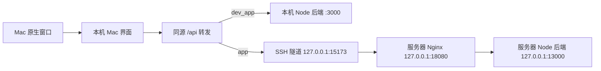

# macOS 桌面版执行计划

编制及复核日期：2026-11-06（Asia/Singapore）。

状态：工程实现、针对性检查与本地 beta 集成完成；视觉、原生交互及真实创作链为 `user_acceptance_pending`。实际状态与验证证据见 [实施进度](desktop_mac/docs/progress.md)，其中包括后续启动修复的实机就绪信号验证。保留下文作为需求和验收基线；未修改后端源码、开放端口或执行真实部署。

## 0. 给执行 Codex 的约定

1. 先读当前 `AGENTS.md`，再按本文件阶段顺序执行。用户之后的明确要求优先于本计划；本文件中的历史探测结果不代替实施时检查。
2. “执行本计划”默认指实现代码、必要配置、文档、阶段提交和代码级验证。允许只读核查服务器；不能据此自动执行真实 `up_app`、推送、晋级 `main` 或公开上传。用户明确要求部署/推送时再执行相应步骤，已有同次会话授权不重复询问。
3. 下文列出的技术栈、模式、端口、配置优先级和命令语义是实施默认值，不留给执行者重新选型。只有源码证据表明不可行时才记录原因、影响和替代方案；不得静默改用 Electron、远程网页套壳或改后端绕过问题。
4. 阶段有两类完成状态：`engineering_done` 表示代码与针对性验证完成；`user_acceptance_pending` 表示等待样式/原生交互验收。等待用户验收时可以继续后续独立工程工作，不得误报完整交付，也不必停止所有开发。
5. 每阶段维护 `desktop_mac/docs/progress.md`：基线提交、变更范围、执行命令及结果、复用验证依据、待用户检查项、下一步。失败只阻塞依赖它的步骤；真实发布必须等相关验收通过。
6. 开始实施时从当前包含本计划的 `ai` 提交建立 `codex/mac-desktop`，保留已有改动。若该分支存在先检查其归属和进度，不重建或重置；需要隔离时用独立 worktree。不得直接从明显缺少 fork 改动的旧 `main` 开始重做。
7. 本轮未建立新的子代理委派授权；后续按当时 `AGENTS.md` 逐项处理授权并选 Luna，不继承上一轮对子代理的许可。

## 1. 目标与范围

在 `desktop_mac/` 实现 macOS 桌面版，窗口、导航、页面布局、颜色、字体和操作体验以 `/Users/likai/go/src/write/wukong` 为参照。桌面版承载本项目的小说创作能力，支持从 AI 规划、正文生产到全书导出的完整流程。

根目录提供六个命令：

| 命令 | 用户得到的结果 |
| --- | --- |
| `make dev_app` | 启动 Mac 桌面版，连接本机后端，用于开发测试 |
| `make app` | 启动 Mac 桌面版，连接指定服务器上的后端 |
| `make stop_app` | 关闭本项目桌面程序及其自有本机辅助进程 |
| `make restart_app` | 按最近一次请求的模式重新构建并启动桌面程序 |
| `make up_app` | 更新指定服务器上的服务版本，重启后端并检查可用性 |
| `make list` | 列出可用 Make 命令、用途和必要配置 |

实施边界：

- Mac 新增源码、样式、原生桥接、启动与部署编排集中在 `desktop_mac/`。
- 不修改 `server/` 业务代码、数据库结构、Prompt、AI 决策、任务恢复规则或现有 API 合同。
- 可调整根目录 Makefile、工作区配置及必要的前端复用入口；这些改动不得改变原 Web 和 Windows 桌面版的默认行为。
- 复用后端和前端业务能力；不将 wukong 的 Go、Python Agent、PostgreSQL 或业务 API 移植进来。
- 样式一致覆盖实际业务页面，而不止窗口边框、首页或侧栏。最终验收前必须覆盖所有向用户开放的页面入口。
- 本阶段交付可从源码启动的 `.app`。公开 DMG、签名、公证和 GitHub Releases 上传不属于六个命令的必要范围，后续需要时单独安排。

允许的工作区差异为 `desktop_mac/**`、根 Makefile / package / pnpm 配置与锁文件 / `.gitignore`、上述必要 `client/**` 复用改动及相关文档。默认不改 `desktop/**`、`shared/**`、`server/**` 和 `infra/server/**`；部署期生成的临时 Nginx 配置属于运维产物。若发现需要改变共享服务合同才能接入，先记录具体阻塞和证据，不悄悄扩大范围。将实施基线记录为 `MAC_BASE_SHA`，用相对此基线的 diff 检查后端零改动，不能混淆已存在的 fork 差异。

## 2. 已核实的项目现状

### 2.1 本项目

| 检查项 | 当前事实 | 实施影响 |
| --- | --- | --- |
| 调查代码基线 | 首轮调查时 `ai` 为 `09c9db63`，计划初版提交为 `66b3cb4c` | 这些是历史基线；实施从包含本计划最新修订的提交建分支 |
| 当前开发机器 | 复核读取为 macOS 27.2、arm64，CLT 路径 `/Library/Developer/CommandLineTools` | 首轮支持当前 Apple Silicon 机器；编译部署目标定为 macOS 14.0，旧系统未实测不声称通过 |
| 前端 | React 19、TypeScript、Vite、Tailwind、项目自有 UI primitives | 沿用现有依赖和业务组件，不另装 shadcn 组件 |
| 现有桌面端 | `desktop/` 为 Electron，包说明为 Windows runtime，版本 `0.6.1` | Mac 独立实现，不改写 Windows 启动、迁移与更新路径 |
| 桌面旧行为 | 现有 Electron 主进程管理本地 Node 服务和桌面数据 | 不能直接套用到连接服务器的 Mac 模式 |
| API 入口 | `client/src/api/client.ts`、`client/src/lib/constants.ts` 已集中管理 API 地址 | 复用请求、错误、超时机制，避免每页拼接服务器地址 |
| 页面路由 | `client/src/router/index.tsx` 集中列出业务路由，当前固定使用 `AppLayout` | 提供可注入布局的稳定入口，Mac 使用独立外壳 |
| 服务器运维 | 已有 `infra/server/`、根目录 `start.sh` / `stop.sh` / `restart.sh` | 使用现有部署边界，不复制另一套服务管理规则 |
| Make | 当前版本控制中没有根目录 Makefile / GNUmakefile | 新增薄 Makefile，具体行为交给模块脚本 |

### 2.2 wukong 参考基线

以下信息来自本地源码和文档检查，尚未进行窗口或截图验收。复核时 wukong HEAD 为 `c610746b`；同时检查其工作区差异，参考的是实际文件，不能只凭提交号推断没有未提交样式：

| 参考位置（相对 wukong 根目录） | 应参考的内容 |
| --- | --- |
| `docs/main.md`、`docs/desktop-runtime.md` | 工程入口、桌面运行模式、窗口恢复与输入保留 |
| `desktop/WukongPrototypeApp.swift` | Swift / AppKit / WKWebView，原生窗口及菜单 |
| `web/src/styles/base.css` | 基础颜色、字体、三栏结构、写作字号 |
| `web/src/styles/app.css` | 64px 图标栏、40px 顶栏、按钮尺寸、列表和画布层次 |
| `web/src/components/layout/NavigationSidebar.jsx` | 图标导航、书籍选择、tooltip、选中状态与计数 |
| `GNUmakefile`、`scripts/app_mode.sh` | 命令入口、请求模式与成功模式、先构建再切换 |

wukong 的 `make app` 仍在 Mac 本地运行其业务后端，通过 SSH 连接服务器数据库；本项目的 `make app` 必须连接服务器上的完整 Node 后端，不能照搬这一拓扑。wukong 使用 `re_app`，未发现 `restart_app` 和 `up_app`；本项目按用户要求实现后两个名称。

### 2.3 服务器只读检查结论

目标：`root@152.136.155.200`，目录 `/data/write/AI-Novel-Writing-Assistant`。

| 检查项 | 2026-11-06 的结果 |
| --- | --- |
| 部署分支 / 提交 | `ai` / `eaa4bd8f`，工作区无已显示的修改 |
| API 监听 | `127.0.0.1:13000` |
| Nginx 监听 | `127.0.0.1:18080` |
| 代理规则 | `/api/` 原路径转发到 `13000`，关闭代理缓冲，读写超时 3600 秒 |
| 进程管理 | `ai-novel-api.service`、`ai-novel-web.service` 均 active/running，运行账户为 `ai-novel` |
| API 健康 | `http://127.0.0.1:13000/api/health` 返回成功、`status=ok` |
| 代理健康 | `http://127.0.0.1:18080/api/health` 返回成功、`status=ok` |
| 数据读取 | 代理后的 `/api/novels?page=1&pageSize=1` 返回 HTTP 200；未输出小说内容 |
| 网络配置 | `HOST=127.0.0.1`、`ALLOW_LAN=false`，CORS 配置包含本机 `15173` 入口 |

结论：后端接口已经存在，Nginx 映射也存在，但仅在服务器本机开放。Mac 应通过 SSH 本地转发使用它，无需修改后端或开放公网业务端口。

原因不是推测：`server/src/middleware/auth.ts` 当前直接 `next()`；`docs/wiki/architecture/server-deployment.md` 明确将 SSH 作为个人部署的访问边界。直接将端口绑定到 `0.0.0.0` 会公开可修改小说、模型设置和任务的接口，不作为本计划的接入方案。

上述检查证明服务器内部 API 和数据库读取可用，不等于已验证 Mac 隧道、WKWebView、AI 流式生成或导出。实施时重新核对部署状态。

## 3. 技术方案与目录职责

### 3.1 原生壳和独立界面

采用 **Swift / AppKit / WKWebView + React / TypeScript / Vite**。原生壳与 wukong 保持一致；前端复用本项目已安装的技术栈与业务能力。

- Swift 负责窗口、菜单、应用生命周期、文件选择和保存，以及最小化的原生桥接。
- React 负责 wukong 风格的工作台与创作页面。
- 本机辅助服务只提供静态资源和 API 转发，不包含业务规则、数据库访问、LLM 调用或任务调度，因此不构成新业务后端。
- 正式模式加载本机构建的 Mac 界面，再经隧道调用远端 API；不能直接显示服务器现有 Web 首页来替代 Mac 样式实现。
- 不加载现有 `client/src/main.tsx` 的 Electron 启动边界；Mac 自行组合 React Query、主题、路由与连接状态。平台能力显式传入，不伪造 Windows 更新、数据库导入或本地引擎状态。

目录职责固定如下，内部文件可按职责细化：

```text
Makefile
desktop_mac/
  README.md
  package.json
  tsconfig.json
  docs/
    progress.md                  # 阶段状态、验证证据与交接
    route-parity.md              # 路由、页面视图、样式和功能覆盖
    acceptance.md                # 给用户的原生/UI 验收步骤
  config/
    app.example.json             # 本机端口、SSH 目标、部署 ref 的示例，不含密钥
  native/
    Sources/
      App/                       # AppDelegate、菜单、单实例与退出
      Window/                    # 窗口状态、显示恢复、WKWebView
      Bridge/                    # 导航白名单、文件选择与保存
    Resources/                   # Info.plist、图标
  renderer/
    index.html
    vite.config.ts
    src/
      app/                       # 启动、provider、运行环境、路由装配
      shell/                     # 导航、顶栏、目录栏、工作画布
      theme/                     # token、样式作用域、字体许可
      features/                  # 小说、导演、编辑器、运行记录等视图适配
      platform/                  # Mac 原生桥接适配
  application/
    lifecycle/                   # 模式、启动、关闭、重启、健康检查
    deployment/                  # 部署计划、备份、构建、切换、回滚
  infrastructure/
    processes/                   # launchd、进程归属、锁、日志
    transport/                   # loopback 静态服务、API 代理、SSH 通道适配
  scripts/                       # Make 调用的薄入口
  tests/                         # 生命周期、传输和部署的针对性测试
```

运行记录与构建产物进入忽略目录 `.runtime/desktop_mac/`，日志进入 `.logs/desktop_mac/`。开发和服务器模式分别保存端口、缓存、窗口/页面状态与进程元数据，防止串用数据。

外部复用入口通过模块 facade 暴露，不持续增加对其他模块内部文件的深层引用。新增单文件超过 1,300 行必须先拆分，目录和模块遵守项目现有职责边界规则。

### 3.2 前端复用边界

1. 在 `client/src/router/index.tsx` 提供 `createAppRoutes({ layout, pageOverrides })` facade：路由有稳定 ID，支持替换布局和页面组件，路径、重定向、功能开关由原路由统一维护。Web 不传覆盖项时完全保持原行为，Mac 的覆盖表集中维护，不能维护第二份独立路径树。
2. 将布局中的必要业务 provider、模型初始化、任务提醒和恢复上下文整理为无视觉依赖的复用入口。替换导航不能丢失这些行为。
3. 复用现有 API、类型、查询缓存、业务 hooks 和编辑器能力；Mac 页面容器与视图适配放在 `desktop_mac/renderer/src/features/`。
4. 对混合业务与视觉的页面，先提取最小稳定复用边界，再构建 Mac 视图。不得整份复制所有前端形成两套业务逻辑。
5. Mac 独立 HTML 在首屏前给 `html` 添加 `data-app-shell="mac"`，样式挂在该作用域，覆盖挂到 `body` 的 Dialog/Select/Toaster Portal；不能只限定在 React 根容器内导致弹层漏样式。映射现有语义 CSS 变量，不对 Web 全局改色，不用跨全站的 `!important` 覆盖堆叠。
6. 保留现有 source route、查询参数和功能开关。运行记录跳回小说、章节或导演工作台时必须定位正确对象。
7. `ThemeProvider` 增加向后兼容的可选锁定参数及独立 storage key，Mac 固定 light / compact 并由 Mac token 决定配色；Web 默认参数不变。Mac 替换外观设置和维护页面，展示实际支持的字体、连接与日志操作，不显示无效的深色切换、Windows 更新或数据库导入按钮。
8. provider 装配至少检查 QueryClient、Theme、CreationSetup、TaskRecovery、LLMSelectionBootstrap、AutoDirectorPauseNotificationWatcher、LiveExecutionDialog、TaskRecoveryDialog、Toaster。它们每个只挂载一次；错误、只读运行记录、编辑器和预览路由不得丢失所需上下文。

### 3.3 工作区、编译与运行配置

- 一个 pnpm 包：`@ai-novel/desktop-mac`，根目录 `pnpm-workspace.yaml` 增加 `desktop_mac`。不再为 renderer 创建嵌套包。
- React/Vite/TypeScript/Tailwind 等版本由工作区锁文件确定。Node 使用根 `engines` 支持的版本，pnpm 使用根 `packageManager` 的精确版本。服务器模式启动前按锁文件补齐本机桌面依赖。缺少 Node、pnpm 或 Xcode Command Line Tools 时提示使用者准备相应工具。
- 编排和适配器用 Node ESM `.mjs`，避免为运行 Make 命令引入额外 TS 执行器；Swift 使用 `xcrun swiftc` 构建原生壳，部署目标 macOS 14.0，默认当前 `arm64` 架构。
- `@/*` 在 Mac 的 TS/Vite 配置中仍指向 `client/src/*`，新增 Mac 代码用 `@mac/*`；`@ai-novel/shared/*` 与现有映射一致。Vite 去重 `react` / `react-dom`，避免跨目录导入形成双 React 实例。
- Mac Tailwind `content` 必须同时扫描 renderer 与被复用的 `client/src`，路径相对配置文件解析；复用 theme 定义但不改 Web 的扫描范围。依赖客户端静态资源的路径也纳入构建验证。
- Mac 使用 `BrowserRouter`，本机服务支持 SPA 回退。运行配置在导入业务模块前注入 `window.__AI_NOVEL_RUNTIME__ = { mode: "web", apiBaseUrl: "/api", appVersion: ... }`；`web` 在此表示复用现有 HTTP 客户端合同，不表示没有原生壳。原生能力另用 `window.__AI_NOVEL_MAC__`，不要扩展后端 runtime 枚举。
- 不复用仅 DEV 生效的 `ServerStartupGate` 作为正式连接检查；实现 Mac 自己的启动/断线状态。丢失配置时直接报错，不回退 `localhost:3000` 或另一个环境。
- `.app` 名称固定为 `AI Novel Mac.app`，Bundle ID 为 `app.ai-novel.desktop-mac`，版本从 `desktop/package.json` 读取。构建产物在 `.runtime/desktop_mac/builds/<fingerprint>/`，不写入 `/Applications`，不默认制作 DMG。
- fingerprint 包括相关源码内容、锁文件、构建配置、Node/pnpm/Swift 版本和架构；不能仅看 Git HEAD，否则未提交修改可能继续使用旧产物。原生壳运行参数传入当前 repo 和模式，不写死开发机路径。

配置默认值及唯一命名如下。优先级为 **命令行 Make 变量/环境变量 > `.runtime/desktop_mac/config.json` > 下表默认值**。JSON 不作为 shell 脚本 source；解析后校验类型、端口范围和路径。

| 配置字段 | 命令行变量 | 默认值 / 规则 |
| --- | --- | --- |
| `localApiPort` | `LOCAL_API_PORT` | `3000`，只允许本机 loopback；不提供远端 URL 给 local 模式 |
| `devUiPort` | `DEV_UI_PORT` | `15174` |
| `appUiPort` | `APP_UI_PORT` | `15175` |
| `tunnelPort` | `TUNNEL_PORT` | `15173` |
| `sshTarget` | `SSH_TARGET` | `root@152.136.155.200` |
| `remoteWebPort` | `REMOTE_WEB_PORT` | `18080`，服务器 loopback 的 Nginx |
| `maintenanceProbePort` | `MAINTENANCE_PROBE_PORT` | `18081`，部署期间服务器 loopback 的临时只读探测入口，冲突时拒绝部署 |
| `serverDir` | `SERVER_DIR` | `/data/write/AI-Novel-Writing-Assistant` |
| `deployRef` | `DEPLOY_REF` | `origin/ai`，保持现有服务器发布线；完整规则见 5.5 |
| 无持久化字段 | `APP_MODE` | 只用于 `restart_app`，取 `local` 或 `remote`；与 `app` / `dev_app` 固定语义冲突时报告参数错误 |
| 无持久化字段 | `DRY_RUN` | 只用于 `up_app`，`1` 为预览，省略为真实执行 |

同一台机器上的界面、API、隧道或维护探测端口必须互不冲突。首次运行无配置文件也应按默认值工作；配置只存非敏感值，文件权限 `0600`，SSH 身份由系统配置解决。

`package.json` 提供固定脚本：`typecheck`、`build:renderer`、`build:native`、`build`（依次构建前两者）、`test`（Node 内置 test runner）。Make 只分发六个用户命令；额外工程检查直接使用这些 pnpm scripts。

### 3.4 两种连接链路



端口采用 3.3 的默认值，实施前检查占用并允许显式覆盖；端口冲突报出归属，不杀占用进程，不暗中换到另一套数据。

- `dev_app` 使用 Vite 和本机 API；API 已经运行且归属明确时复用，否则由本命令启动现有后端开发入口，并记录所有权。
- `app` 使用构建后的静态资源与固定目标代理，不启动本机业务后端。已有 `infra/server/tunnel.sh` 创建的通道只有在 SSH 目标、两端端口和进程归属均核对后才复用，记为 borrowed。新通道由 Mac 的 launchd job 以前台 `ssh -N -T -L` 管理，沿用原脚本的 BatchMode、ExitOnForwardFailure、心跳和主机校验参数；不要把 `autossh -f` 再嵌进 launchd 造成两层监督。无需修改原通道脚本。
- 原生 WebView 只加载配置的 loopback 页面；外部链接由系统浏览器打开。脚本桥接只接受可信页面和明确动作，禁止传任意 shell 命令。
- 统一使用相对 `/api`，使 axios、fetch/SSE、上传、图片和导出共用同一连接；辅助服务须支持 SPA 深链接回退，刷新不会返回 404。
- API 转发保留状态码、请求体、必要请求头与响应头，流式响应逐块转发、支持取消，不整体缓存，不使用短超时截断 AI 输出。断线不自动重放生成或保存请求。
- 文件上传、Blob 下载、`Content-Disposition`、本地图片地址和 SSE 在早期兼容性阶段逐项验证。下载通过 WKWebView / 原生保存对话框适配，不改后端合同。
- 切换模式采用完整的应用重启，重新创建查询缓存并隔离草稿存储；不在编辑中静默切换 API。界面持续显示“本地测试”或“服务器”。
- 保留 SSH 主机校验，使用系统 SSH 身份，不把私钥或服务器密钥写入应用、Git、命令日志或示例配置。

本机代理的具体规则：

- 仅绑定 `127.0.0.1`；上游在启动时固定，不能通过 URL、请求头或 IPC 指定任意目的地址。验证 Host 和 Origin，跨来源请求拒绝，不设置宽松的 `Access-Control-Allow-Origin: *`。
- 代理 `/api` 及 `/api/` 边界路径；未知 API 返回上游错误，不返回 HTML。SPA 回退只处理非 API、非资产的 HTML 导航；静态文件路径拒绝 `..`、编码穿越和越界符号链接。
- 转发浏览器 Origin 时使用目标认可的内部 Origin 或按服务端代理方式移除它；由本机入口先完成来源校验。禁止为解决 CORS 去修改服务器后端白名单或关闭 WebView 安全限制。
- 开发模式 Vite proxy 和正式 Node proxy 使用相同的目标解析与头部策略；验证 Vite HMR 所需的 WebSocket，不能误当作后端新增 WebSocket 合同。
- 非流式请求沿用客户端超时，流式代理不得早于现有 3600 秒读写配置截断；正确处理背压、客户端 abort 与上游断开，不给 SSE 做 gzip 整包缓冲。
- 本地图片相对路径、`data:` / `blob:` 和现有外部 HTTP(S) 资源按各自用途处理；只限制主框架导航，不一刀切禁掉图片、字体或下载。动态绝对内网地址在客户端传输适配层处理，不全局替换小说文本。

### 3.5 原生协议与草稿保护

- 每个 `mode + backendIdentity` 使用独立持久 WKWebView 数据存储。本地 identity 使用仓库真实路径和已校验测试库标识，远端 identity 使用 SSH 目标、部署目录和服务器目标端口，规范化后取哈希，不包含凭据。本机 UI/隧道端口不参与 identity；修改真实后端身份创建新存储，保留旧草稿但不自动搬运。不同后端不得共享 localStorage、IndexedDB、cookie 或查询缓存。
- 创建一份有版本的 Mac bridge 合同，列出 `rendererReady`、`requestSave`、`requestClose`、`closeDecision`、`openExternal`、文件选择/下载需要的消息。请求带 requestId，验证可信主框架、消息类型和字段上限；原生凭据、任意路径读写和 shell 执行都不暴露给页面。
- 现有章节草稿仅使用 `sessionStorage`，且只监听 `beforeunload`；这不足以保证关闭原生窗口后恢复。对原有 hook 增加可选的草稿存储/离开保护适配器，Web 默认不变；Mac 将未保存草稿存入该后端独立存储，保留 savedUpdatedAt 并复用现有冲突判断，不能自动覆盖服务器新内容。
- 离开保护由共享前端注册 dirty/busy 状态及已有 save 回调；native、路由切换和命令退出共用该入口，不通过抓取 DOM 文本判断是否未保存。所有本轮复用的可编辑页面登记其保护能力，不能只保护章节编辑器。 静态路由能力不能当作未保存状态；未编辑或保存完成的页面不得强制确认。未接入真实状态的表单在 route-parity.md 明确记录，沿用页内保存，不用通用弹窗冒充保护。
- 关闭协议：原生 `NSApplication`/窗口 delegate 延后退出 → 页面返回允许退出，或显示“保存并退出 / 放弃未保存修改 / 取消” → 保存成功才允许关窗。保存失败或取消保留应用与辅助进程；busy 状态按已有工作流处理，不代替用户取消后端任务。
- 命令通过仅当前用户可访问的 Unix socket 请求 native 正常退出，不用 SIGTERM 模拟用户确认。socket 放在 `/tmp/ai-novel-mac-<uid>/<repoHash16>.sock`，父目录 `0700`，校验所有者及非符号链接，避免长仓库路径超过 macOS socket 长度限制。最多等待 60 秒，超时退出非零并保留窗口；不得在超时后强杀。后台 helper 的停止只有在 native 已确认退出后发生。
- `⌘Q` 与 `stop_app` 都退出本仓库 App 会话；红色关闭按钮只关窗口，App 保留且 Dock 可重新打开，窗口重新创建时从同一隔离存储恢复页面/草稿。launchd 不把用户主动退出的 App 无限拉起。
- 下载先验证现有 Blob/anchor 路径；不支持时使用 WKDownload 或受控保存适配器，复用现有导出 API。不要把整本小说编码成无上限的 JS bridge 消息。

## 4. wukong 样式和操作验收基线

### 4.1 视觉规格

| 部分 | 基线 |
| --- | --- |
| 窗口 | 默认 1440×900，可缩放，隐藏标题文字、透明原生标题栏、标准红黄绿按钮、保存窗口位置 |
| 缩窄策略 | 最小窗口 390×600；内容区小于 960px 时辅助面板改抽屉，小于 640px 时目录/正文单面板切换，保留 64px 图标栏；不切回旧 Web 的移动版外壳 |
| 导航 | 固定 64px 图标栏，当前页面灰底选中，hover/focus tooltip，计数 badge |
| 顶栏 | 40px，横跨列表与画布；列表开关和 13px/500 标题位于左侧 244px 槽位，与原生标题区域协调 |
| 次级列表 | 默认 244px，可折叠；按上下文展示，顶部独立搜索区；32px 搜索框、7px 圆角、12px 字号，8px 外间距 |
| 按钮 | 主要导航按钮 32×32px、6px 圆角、16px 图标、1.5px 描边；导航间距 3px，图标灰色 `#6e6e6a` |
| 外侧转角 | 中栏顶部左角 16px；中栏展开时画布无左上圆角，折叠时圆角转移到画布 |
| 主背景 | `#fafafa` |
| 侧栏 / 面板 | `#eeeeee` / `#e9e9e9` |
| 列表底色 / 轻内容底色 | `#f4f4f2` / `#f7f7f7` |
| 正文 / 次级文字 | `#242424` / `#878787` |
| 分隔线 | `#d8d8d8`，仅用于必要分区 |
| 图标栏 hover / 选中 | `#dddddd` / `#c6c6c6` |
| 中栏 hover / 选中 | 52% 白色 / `#dce9f2`；选中项左侧 3px `#3988ad` 标记，行圆角 7px |
| 列表文字 | 导航行 13px；双行条目标题 13px/600、说明 11px `#7d7d77`，选中说明 `#66757c` |
| 强调 / 文本选择 / 危险 | `#2999bf` / `#0a84ff` / `#b84e47` |
| UI 字体 | macOS 系统无衬线优先，中文 PingFang，默认 14px |
| 写作正文 | 对齐 wukong 的 LXGW WenKai，默认 20px、1.6 行高；随字体保留 `LXGWWenKai-OFL.txt` |
| 分栏动画 | 参考 180ms，并尊重减少动画的系统偏好 |
| 色彩模式 | 首轮固定 wukong 当前浅色基线；参考源码未提供完整深色主题，不自行设计另一套默认外观 |

原生窗口与页面顶部一起验收，避免标题栏和工具栏重叠。普通内容靠留白、字号、对齐和背景层次分组；不复制参考项目中与本项目低边框规则冲突的常驻阴影、嵌套卡片边框。弹窗、菜单、输入和选中状态保留必要边界。

### 4.2 操作方式

- 常用入口固定位置，新建与书籍选择可快速到达；书内目录位于次级栏，正文使用主要画布。
- 图标栏同时具备 tooltip、可访问名称和键盘焦点；新手主要页面保留“下一步”与清晰默认操作，不能只留下无说明图标。
- 对齐 macOS 的 `⌘Q`、复制粘贴、撤销重做、窗口重开、前进后退；`⌘S` 接入页面已有保存能力，不能另造保存逻辑。
- 重载、退出、重启涉及未保存输入时走页面保存/确认流程；取消后保留当前窗口。命令输出明确需要在窗口处理的情况。
- 参考 wukong 的显示恢复原则：屏幕切换、唤醒先恢复显示，WebView 异常不能无提示重载并丢失正文。
- 顶部连接信息使用简短用户语言；故障提示区分“本机服务未启动”“服务器连接中断”“请求失败”，提供对应下一步。

### 4.3 页面覆盖

| 批次 | 页面范围 | 完成标准 |
| --- | --- | --- |
| 样式样板 | 书架、章节编辑器、设置、运行记录 | 同时覆盖列表、写作画布、表单与记录四类布局，供用户先确认整体风格 |
| 核心创作 | 创建小说、创作中枢、AI 规划、自动导演、小说工作台、章节编辑与预览、导出 | 完整创作链可用，所有状态呈现遵守既有合同 |
| 素材和配置 | 世界、角色、知识库、书籍分析、风格、题材、故事模式、标题、Prompt、模型及系统设置 | 列表、详情、表单、弹层均采用同一视觉规范 |
| 其他现有入口 | 市场雷达、短篇、短剧、漫画、帮助、跟进与用量等启用路由 | 按路由清单逐项完成；不能以旧 Web 页面可打开代替样式验收 |

保留两条产品约束：运行记录只读，仅查看和返回来源页；自动导演的局部质量债务显示为警告，质量优先的人工暂停与必须重规划保持后端原状态。不得因 Mac UI 简化将它们合并成一种失败，也不得在轮询或重连时自动恢复任务。

页面清单以实施时 `createAppRoutes` 为准，至少登记下列现有路径（包含重定向和功能开关）；`route-parity.md` 每行记录路由 ID、Mac 视图、共用逻辑入口、dirty guard、工程验证和用户验收状态。磁盘上存在但原路由未开放的页面不自动扩大为新增功能。

| 组 | 必须登记的路径 |
| --- | --- |
| 入口与创作 | `/`、`/help`、`/novels`、`/create`、`/novels/create`、`/novels/auto-director`、`/creative-hub`、`/chat-legacy` |
| 小说 | `/novels/:id/simple`、`/novels/:id/story`、`/novels/:id/edit`、`/novels/:id/chapters/:chapterId`、`/novels/:id/preview`、`/novels/:id/ai-usage` |
| 导演与记录 | `/lab/director`、`/lab/director/:novelId`、`/tasks`、`/auto-director/follow-ups` |
| 分析和素材 | `/book-analysis`、`/market-radar`、`/knowledge`、`/genres`、`/story-modes`、`/titles`、`/prompt-workbench`、`/anti-ai-rules`、`/worlds`、`/worlds/generator`、`/worlds/:id/workspace`、`/style-engine`、`/base-characters` |
| 短剧与漫画 | `/drama`、`/drama/projects/:id`、`/comic`、`/comic/projects/:id` |
| 设置 | `/settings`、`/settings/models`、`/settings/model-routes`、`/settings/director`、`/settings/knowledge`、`/settings/maintenance`、`/settings/appearance` |
| 兼容跳转 | `/chat`、`/writing-formula`、`/auto-director/follow-up-center`、`/auto-director/followup-center`、未知路径回退 |

导航固定为：顶部新建、书架、创作中枢、自动导演、运行记录；素材与其他工作台进入可展开的功能菜单；次级列表随当前菜单显示作品、对话、创作记录、状态筛选、项目或分类；当前书籍选择器及章节目录仅在书内页面保留；设置与帮助放底部。图标以项目现有 lucide 为基础，尺寸和交互对齐 wukong，不照搬 wukong 的业务命名。现有深链接仍可直接访问，不因入口收纳丢失功能。

样式验收至少使用 1440×900、1024×768、390×600 三种窗口尺寸，逐项检查：导航/顶栏尺寸、颜色和字体、列表密度、写作区、Portal 弹层、focus/hover、错误/空状态。页面不得横向整体溢出，表格可在自己的区域滚动。对照由用户手动完成；不能用源码 token 相同推断实际视觉已一致。

## 5. Make 命令的行为合同

### 5.1 `make dev_app`

1. 检查 macOS、Xcode Command Line Tools、Node/pnpm、依赖与端口。
2. 写入 requested mode=`local`，使用现有 `server/.env` 和本地测试数据，验证解析后的数据源确为本机测试库。不得把 SSH 转发的数据库当作本机库，也不复制远端 `.env`。缺配置或库结构时明确报错，启动脚本不额外执行迁移、seed、重置或导入。
3. 准备 shared 与必要客户端产物；工作区注入依赖按现有规则同步。复用根 `dev:shared` 和 `dev:server` 所指向的已存在入口，不新增另一套业务启动器。
4. 先识别 API 端口占用。仅当完整命令、工作目录和仓库归属可证明是当前本地后端时复用；其他占用报错。空闲时以 `AI_NOVEL_RUNTIME=web HOST=127.0.0.1 PORT=<localApiPort>` 启动，记录 owned。不能仅凭 `/api/health` 返回成功判断归属。
5. API 启动后再等待健康和数据库读取检查，随后启动 Vite 与原生 `.app`；全部就绪后记录 running mode。若复用现有后端，shared watcher/Prisma 准备也需避免和该服务构建冲突。

已有后端启动会执行它原有的兼容性初始化、资源补齐和后台恢复；本计划不修改这些行为，也不能承诺“启动时数据库绝无写入”。Mac 包装脚本不得增加数据库维护或任务恢复调用。

验收：编辑与生成请求只进入本机后端；重复执行不产生重复进程；不会将测试数据写入服务器。

### 5.2 `make app`

1. 先写入 requested mode=`remote`，构建或复用未失效的 Mac 静态资源与原生壳；失败保留原运行版本。
2. 检查 SSH 身份、已知主机、隧道目标及本地端口。已有正确隧道可复用，不依赖用户先手工执行映射命令。
3. 检查经隧道的 `/api/health` 与数据库读取接口。
4. 启动本机静态资源/API 代理和 `.app`；native 出窗、rendererReady、API/数据库检查全部通过后才更新 running mode。

验收：请求到达 `152.136.155.200` 对应部署；本机业务后端关闭时仍可运行；退出终端不导致窗口依赖的辅助服务消失。

### 5.3 `make stop_app`

- 请求原生应用正常退出，处理未保存输入，再停止其自有界面服务。owned 本机后端只有在只读检查确认没有活跃/待执行任务时才停止；仍有任务或状态无法确认则保留并明确输出“桌面已关闭，本地创作服务继续运行”，不把关窗口解释成取消创作。
- 仅停止本命令创建、且归属校验成功的隧道；复用的共享隧道保留。归属不明时停止操作并报告，不按端口或进程名批量终止。
- 永不停止服务器 `ai-novel-api` / `ai-novel-web`，不影响 wukong 或其他项目。
- 保留小说、草稿、配置、日志和最近请求模式；应用未运行时成功返回。
- 被保留的本机后端仍记录 owned 身份和保留原因，后续 `dev_app` 优先复用；单独存在的后端不算仍有桌面窗口运行。重复 `stop_app` 可重新检查其是否已空闲，不能强停。

### 5.4 `make restart_app`

- 按最近请求模式重新构建并重启，区分“请求模式”和“最后成功运行模式”，启动失败后可以重试同一模式。
- 没有历史记录时默认 `remote`，输出说明；可用 `APP_MODE=local` / `APP_MODE=remote` 显式选择。
- 构建与依赖预检在停止原窗口前完成。通过归属校验后只替换本次所需进程；复用的本地后端和共享隧道不无故重启。
- 不部署服务器，也不把重启桌面解释成恢复创作任务。
- 同模式 start 已健康时聚焦现有窗口，不重复构建/重启；需要重新构建用 `restart_app`。不同模式 start 等价于一次显式模式切换，也必须走保存/退出协议。新模式启动失败时尝试恢复上一个成功版本及模式，requested mode 保留失败目标供再次重试。

### 5.5 `make up_app`

作用为部署服务器服务；不负责更新本机 `.app`，也不自动执行 Git 推送、功能分支合并或公开桌面包上传。

默认主机和目录为用户指定值。**默认 `DEPLOY_REF=origin/ai`**，对应当前服务器已使用的发布线；每次先核对 `origin` 是否为本 fork，再将该远端 ref 解析成固定 SHA。真实执行可以 fetch，dry run 使用只读 `ls-remote`/现有对象检查，不能用本地未推送 HEAD 冒充远端版本。完整 SHA 也必须能证明属于配置的发布线且有对应验证记录。

这不是将新 Mac 功能从 feature 直接发布到 `ai` 的许可。Mac 功能仍经 feature → beta → main；需要将服务器发布线改为 `origin/main` 时明确修改部署配置并记录迁移决定，不能根据分支名猜测。候选 SHA 必须等于当前部署或是其后代；不允许自动降级、强制覆盖分叉或切换服务器分支。候选与当前相同且健康时幂等返回，无需重启。

本次约束“不修改后端代码”指 Mac 实施不得编辑后端业务；`up_app` 可以部署已在发布线上完成验证的现有后端版本，但不能顺带合并、修复或生成后端改动。

执行顺序：

1. 获取本机生命周期/部署锁和服务器 `.runtime/deploy.lock`，记录旧提交、服务状态、数据绝对路径、候选 SHA 和验证依据。服务器受控源码有修改、分支分叉、未知部署状态、空间不足或验证依据缺失时退出，不 stash/reset 服务器工作区。备份、候选、旧产物必须有足够空间，不能靠删除旧数据腾空间。
2. 比较两种 Prisma schema、两套 migrations、启动数据库兼容逻辑及相应依赖变更。存在待应用迁移或无法证明回滚兼容时，普通 `up_app` 拒绝执行；不得只比较迁移目录就宣布无需迁移。
3. 在服务器 `.runtime/desktop_mac-deploy/candidates/<sha>/` 准备完整受控源码，按 `infra/server/README.md` 冻结安装 server/client 依赖、构建 shared、离线刷新注入依赖、生成 SQLite Prisma client、构建 server/client。候选不启动业务进程，不连接生产库，不带入生产模型密钥；不在 Mac 生成 Linux 原生依赖。
4. 构建前后都不覆盖运行目录。生成部署清单，列出要切换的源码、`node_modules`、各包依赖目录及 shared/server/client 构建产物；校验 pnpm 相对链接在最终根目录仍可解析，不允许链接回会被清理的候选绝对路径。
5. 在 `.runtime/desktop_mac-deploy/backups/<timestamp>-<oldSha>/preflight/` 保存旧提交的 Git bundle、受控文件快照、完整旧依赖与构建产物、配置副本、数据库一致快照和资产归档。SQLite 使用 backup API / `.backup`，检查文件存在、非零、`PRAGMA integrity_check=ok`；资产/配置记录清单和校验值。目录 `0700`，秘密文件 `0600`，不输出密钥，不自动删除备份。
6. 再获取与现有脚本相同的 `.runtime/service-control.lock`，进入下述维护窗口并再次核验静止状态；停服务后在同一备份批次的 `quiesced/` 保存数据库、资产和配置的最终一致备份并复验，不覆盖 preflight 快照。所有检查通过后才切换，保留两项服务的原启停状态。
7. **首版使用原部署根目录内的停机事务式切换**，不改 systemd WorkingDirectory、不引入未经实现的 `current` 软链布局：受控源码只做 `git merge --ff-only <sha>`；旧依赖/产物按明确清单重命名到 rollback 槽，再把候选对应目录移入原位置。日志记录每个完成步骤，失败或进程中断后可以从记录恢复。保护目录永不进入替换清单。
8. 在锁内通过 systemd 启动这两项既有服务。adapter 必须沿用 `infra/server/control.sh` 的工作目录归属校验、Nginx 校验和健康标准；已持有同一锁时不能递归调用会再次加锁的 `control.sh`。先从维护探测入口检查 API、网页及小说读取，再撤销维护配置并检查正常 `18080` 入口；记录 SHA、构建 fingerprint、备份路径和结果。更新 `.runtime/deployment.json` 时保留已有未知字段，同时保存本模块的详细记录。
9. 失败则保持维护入口、停止失败版本、按记录恢复旧依赖/产物，并用非强制 `git switch --detach <oldSha>` 恢复旧源码后启动。不得 hard reset、覆盖未提交变化或回退数据库。回滚后如为 detached HEAD，报告该状态，后续部署必须先核对恢复发布分支；不能假装仍跟踪正常发布线。

事务范围必须包含依赖和运行时资源，不能只备份 `server/dist`。保护清单至少为 `.git`（由受控 Git 命令管理）、`server/.env`、`data/` 及 WAL/SHM、`server/storage/`、`.runtime/`、`logs/`、`.logs/`；远端 `.env` 中指向的其他持久路径也要枚举。候选新增同名受控文件或符号链接指向保护路径时拒绝发布。全过程不进行删除式 rsync、数据库还原或清理旧发布。

维护窗口与任务检查：

- 现有 `server/src/app.ts` 有 `close()` 能力，但直接启动路径没有已核实的全局 drain/SIGTERM 协议；本计划不能承诺零中断热更新，也不能为部署修改后端增加新协议。
- 在 `desktop_mac/application/deployment/` 实现只读 quiescence 检查，依据实际 task/worker 合同登记覆盖表，覆盖导演新旧链路、章节生产、短篇、拆书、图片、风格及 RAG 等持久任务。检查 queued/running/自动重试候选和有效租约，遍历分页；`/api/tasks/overview` 单次汇总不作为充分证据。未知任务类型、读取失败或覆盖不足必须拒绝部署，不能将其视为零任务。
- 人工暂停/等待批准与活跃执行区分；检查只能读，不改状态、取消、重试、清租约或触发恢复。只读访问可使用现有 API 或服务器 SQLite 的只读连接，不导入会初始化 worker 的业务模块。
- 初检通过后，临时让正常 `18080` 的 `/api` 入口返回带 `Retry-After` 的 503，**保留只读 `/api/health` 和静态 `/`**；另在服务器 `127.0.0.1:18081` 建立仅 GET/HEAD 的维护探测入口，供有界、无副作用的检查使用，不向 Mac 转发。先备份配置、`nginx -t` 再 reload；配置精确匹配规则必须保证健康检查不会被 503 覆盖。
- 关闭新请求入口后至少两次静止检查，间隔 5 秒；同时检查旧 Nginx worker/现存 API 连接，确保 reload 前建立的流式请求已经结束。直连 `13000` 的其他调用方或未识别连接也计入占用，不能只看 Nginx 新 worker。确认没有活动请求/租约及可自动启动队列，随后停止 API 和 Web。任务条件变化即恢复原 Nginx 配置并退出，不强行停止正在生成的内容；覆盖不足时拒绝部署，不设跳过保护的 FORCE 参数。
- 任一步失败都恢复原代理配置和适当的旧服务状态；临时 `18081` 监听也必须消失。锁顺序固定为本机生命周期锁 → 本机部署锁 → 远端 deploy.lock → 远端 service-control.lock，失败路径反向释放。维护完成的成功/失败通知写到命令输出与部署记录，不向任务中心添加操作入口。

实现 `make up_app DRY_RUN=1`：仅输出目标主机、目录、固定提交、差异摘要、备份/替换清单、将执行的步骤和检查结果，不传输、不 fetch 到远端仓库、不创建远端锁/目录、不构建、不停止、不改代理、不切换服务。若只读信息不足，标为“尚未验证”，不能宣称可部署。自动测试使用隔离的假 SSH/进程适配器，不以真实服务器部署代替测试。

### 5.6 `make list`

从带说明的 Make 目标生成帮助，至少显示六个命令及 `APP_MODE`、部署目标配置、`DEPLOY_REF` 和 `DRY_RUN=1` 的用法。仅打印信息，不检查 SSH、不构建、不启动服务；无桌面依赖时也能使用。

### 5.7 共同生命周期要求

- 单仓库单活动桌面模式，使用锁防止 start/restart/deploy 并发竞争；为保护任务而保留的本地后端可独立存续。
- 进程记录包含仓库绝对路径、角色、PID、启动时间、完整命令标识及模式；发信号前重新校验，防止 PID 复用。
- 后台辅助进程采用当前用户图形会话的 launchd，标签包含仓库真实路径的稳定哈希、模式和角色，支持终端关闭后继续运行。使用受控绝对可执行路径和显式 PATH，不假定 launchd 能读到交互 shell 的 Node/pnpm。
- 所有启动失败都输出失败阶段、日志位置和重试方式；不把健康接口成功当成整个桌面功能已验收。
- 日志按角色分文件，默认每文件 10 MiB、保留 5 份；不记录模型密钥、完整环境变量、正文、表单内容、上传/下载载荷。异常详情保留状态码、请求 ID 和阶段即可。
- 普通启动、关闭和重启不额外执行数据库维护或业务恢复指令；原后端自身启动行为保持原样。持久化数据不进入构建清理列表。

实现状态文件 `.runtime/desktop_mac/state.json`，采用临时文件写完后原子 rename，至少含 `schemaVersion`、`repoRealPath`、`requestedMode`、`runningMode`、`backendIdentity`、`buildFingerprint`、`previousSuccessfulBuild`、各进程的 `owned/borrowed` 归属。损坏时不能猜 PID 或默认杀进程，应停止突变操作并输出恢复说明。

Make 目标全部声明 `.PHONY`，默认目标为 `list`；直接 `make` 不启动应用。脚本必须兼容 macOS 自带 Bash 3.2/BSD 命令，不依赖 GNU `readlink -f`、`sed -i` 或本机 `flock`；本机锁由 Node 原子目录创建加身份校验实现，Linux 部署锁可用现有 `flock`。

启动检查默认总等待 120 秒，每次网络探测不超过 5 秒；rendererReady 等待 30 秒；停止确认 60 秒。每阶段立即输出进度和日志位置。脚本退出码约定：0 成功/幂等无事可做，2 配置错误，3 用户取消/等待确认超时，4 归属或端口冲突，5 构建/连接/健康失败，6 部署前置检查拒绝，7 部署失败但代码回滚成功，8 回滚也失败。GNU Make 自身可能把失败归一为退出码 2，输出必须保留内部错误码和原因，不能要求调用者从 make 的退出码区分所有故障。

## 6. 分阶段实施与交付

### 阶段 0：基线与实施分支

- [x] 核查现有桌面端、前端入口和服务器运维脚本。
- [x] 核查 wukong 技术栈、样式值和 Make 语义。
- [x] 只读确认服务器端口、健康、数据库读取与 systemd 归属。
- [x] 开始实施时复核这些事实，记录参考项目提交和当前工作区差异、`MAC_BASE_SHA`。
- [x] 创建 `codex/mac-desktop` 功能分支，明确已验证的基线；不在 `main` 或退休的 `desktop-dev` 上展开新功能。
- [x] 按 3.3 使用固定默认值并检查本机工具、架构和端口；仅事实冲突时修改方案，不能在未验证时声称兼容全部 Intel / Apple Silicon Mac。
- [x] 记录 `main..ai` 已有差异。复核时其中包含服务器运维与章节规划的既存改动，不能在合入 beta 时把它们误算为本次 Mac 新增或忽略其集成验证。

交付：基线清单、页面覆盖清单、配置示例。退出条件：本地与服务器模式的目标和数据边界均明确。

### 阶段 1：原生壳与连接兼容性

- [x] 建立 `desktop_mac` 工作区、Swift 壳、React 入口及最小 Make 启动链。
- [x] 建立同源 API 代理、SSH 隧道适配及本地/服务器模式隔离。
- [x] 打通健康检查、小说读取、现有 SSE 消费、上传/下载适配和路由回跳。
- [x] 提供原生保存、外部链接、退出与重载保护的必要桥接。
- [x] 在最小壳阶段就提供可用的 `stop_app`、`restart_app` 和 `list`；不能先启动一套没有安全退出方式的应用，等阶段 5 才补生命周期。

交付：两种模式可启动的最小桌面版。退出条件：Swift 编译、前端类型/构建和传输针对性测试通过；WebKit 编辑与流式表现列入用户验收。若发现现有浏览器组件不兼容，先在 Mac 前端适配，不扩大为后端改造。

### 阶段 2：wukong 风格外壳与样式样板

- [x] 落地颜色、字体、窗口、图标导航、顶栏、列表栏和工作画布。
- [x] 完成书架、章节编辑器、设置、运行记录四类样板。
- [x] 对照第 4 节逐项核对源码值，清除重复边框与页面开发说明文案。
- [x] 提供用户手动验收步骤，优先送验整体风格；等待反馈期间继续独立工程项，已给出的样式反馈及时应用到后续页面。

交付：可操作的统一样式样板。工程退出条件：代码检查通过并形成逐项对照清单；用户尚未验收时标为 `user_acceptance_pending`，不宣称“与 wukong 一样”已经通过。

### 阶段 3：完整小说创作链

- [x] 创建小说、创作中枢、AI 规划、自动导演、小说工作台和章节编辑依次接入 Mac 布局。
- [x] 补齐卷章切换、保存、AI 流式生成、预览与导出。
- [x] 保留任务来源导航、暂停状态、质量债务、显式恢复和书级投影。
- [x] 检查断线、切换模式、窗口恢复与未保存输入的处理。

交付：本地与服务器两种连接下的创建到导出能力。工程退出条件：复用的合同测试与必要新增回归通过；真实 AI 与 UI 操作由用户使用测试小说验收，未完成时保留验收状态，不批量修改生产小说。

### 阶段 4：其余页面与交互一致性

- [x] 按路由清单完成素材、配置、分析及其他启用模块。
- [x] 统一表单、空状态、错误状态、加载、弹窗、菜单、表格、滚动与快捷键。
- [x] 核对当前书籍、章节与运行记录的导航上下文，避免切页后丢失定位。
- [x] 完成宽窗、缩窄、输入法、唤醒、文件保存等用户验收清单。

交付：所有开放页面均纳入 Mac 样式。退出条件：没有无说明的旧 Web 样式入口或因省略 provider 导致的功能缺失。

### 阶段 5：六个命令与部署闭环

- [x] 完成幂等启动、模式持久化、进程归属、正常退出、重启及日志。
- [x] 完成 `up_app` 的 dry run、固定版本构建、备份校验、切换与代码回滚。
- [x] 完成 `make list` 与可直接照做的使用说明。
- [x] 使用隔离测试覆盖端口冲突、残留 PID、SSH 失败、构建失败、未保存退出取消和部署失败。

交付：六个命令满足第 5 节行为合同。退出条件：针对性测试通过，真实更新安排在发布条件满足且无活跃生成任务时；本轮计划不执行部署。

### 阶段 6：集成、验收与收尾

- [x] feature 分支完成各阶段提交与针对性检查，再合入 `beta`。先检查远端是否已有 beta；无 beta 时从已核对的 main 建立，再将继承的 ai 基线差异和 Mac 增量分别列入集成范围，不覆盖已有 beta 工作。
- [x] 在 `beta` 检查 Mac 与原 Web / Windows 共享前端入口的兼容性；复用同一代码范围已有验证，避免重复全量构建。
- [ ] 用户完成样式和交互验收后，补齐发现的问题；明确尚未测试的系统和架构。
- [ ] 相关用户验收和集成检查通过且在当前发布授权范围内时，再晋级 `main`、对齐 `beta`。否则交付可验收的 beta 和待办，不宣称已发布。按仓库规则在分支已合入 beta 且确无后续工作时清理开发分支，保留所需提交证据。
- [x] 更新 `desktop_mac/README.md`、相关 wiki、发布说明及 README 最新更新。

如以后公开桌面包，仍以 `desktop/package.json` 的稳定版本及严格匹配的 `vX.Y.Z` tag 作为项目发布依据；Mac 元数据从同一来源派生，不能新建独立版本线绕过规则。公开打包优先使用已核实的 GitHub 工作流，不在本次计划中触发。

## 7. 验证与完成判定

| 范围 | 工程验证 | 用户验收 / 限制 |
| --- | --- | --- |
| 原生壳 | Swift 编译、桥接输入与导航边界检查 | 原生窗口、菜单、输入法、睡眠唤醒 |
| 界面 | Mac 类型检查和构建，必要的前端复用合同测试 | 与 wukong 对照样式、布局、缩窄和页面交互 |
| 接口 | 代理状态码、流式、取消、上传、下载；本地和隧道只读探测 | 真实生成、保存、导出，以测试小说操作 |
| 生命周期 | 模式切换、重复启动、进程归属、失败保留旧版本 | 终端关闭、正常退出取消、Dock 重开 |
| 部署 | dry run 和隔离适配器验证备份门槛、切换失败与回滚 | 正式执行后只读检查版本、服务与数据访问 |
| 兼容性 | 被修改的共享前端入口进行针对性验证 | 不宣称未测的 Windows、macOS 版本或架构已通过 |

遵循项目规则：不默认运行浏览器、截图、Playwright 或人工 UI 操作验证，UI 验收交给用户。代码级检查通过不能代替视觉或原生行为验收。仅文档阶段执行内容核对和 `git diff --check`，不运行全量测试或桌面打包。

### 7.1 固定工程命令

以下命令在相应 scripts 建立后执行，并记录代码提交/差异指纹。不得把本文件中的命令当作本轮已经运行的结果。

```bash
# 每个阶段：空白与提交范围
git diff --check
git diff --name-only "$MAC_BASE_SHA" -- server shared desktop

# Mac 包：按受影响范围选择，阶段 1 与最终集成必须覆盖
pnpm --filter @ai-novel/desktop-mac typecheck
pnpm --filter @ai-novel/desktop-mac test
pnpm --filter @ai-novel/desktop-mac build

# 只有共享前端入口改动时；最终集成至少做一次
pnpm --filter @ai-novel/client typecheck
pnpm --filter @ai-novel/client build
pnpm --filter @ai-novel/client build:desktop

# 新 Makefile 已建立后：只读帮助与配方预览
make list
make -n dev_app app stop_app restart_app up_app
```

`MAC_BASE_SHA` 必须来自阶段 0 的真实基线，不得留空；scope 检查中 `server/shared/desktop` 应无本次新增差异。已有后端服务不受改动时无需全量 server 测试；beta 若包含先前未验证的 fork 后端改动，另做对应集成检查，不用 Mac 类型检查代替。`build:desktop` 只验证现有 Windows renderer 入口，不等于 Windows 安装包验收。构建已包含相同代码的 typecheck 时，记录该覆盖并复用，不机械地重复；相同输入的近期成功构建也按项目规则复用。避免在 Make 解析期使用有副作用的 `$(shell ...)`，保证 `make -n` 真正不启动服务。

### 7.2 必须覆盖的针对性案例

| 案例 | 明确的预期 |
| --- | --- |
| 本地/远端路由 | 同一请求在两种模式只到对应测试上游；配置缺失/冲突不回退另一环境 |
| 流式响应 | 上游结束前客户端已收到首块，中文跨块不乱码；取消会释放上游请求；重连不重放写请求 |
| 代理边界 | 错误状态和二进制上传/下载完整保留；跨 Origin、任意目标、路径穿越被拒绝；API 404 不返回首页 |
| 应用归属 | 对端口上的无关进程、伪造/复用 PID、borrowed API/隧道不发送停止信号；owned API 仍有任务时保留 |
| 失败切换 | 新构建失败时原应用继续运行；关窗取消时 helper 不停；启动失败可恢复上一成功模式 |
| 幂等与锁 | 重复 start 聚焦原窗口；并发 restart 被锁串行化；异常锁不得仅按过期时间强行清除 |
| 草稿 | 关闭重开能恢复 Mac 草稿；本地/远端、不同后端不串存储；服务器有新版本时不自动覆盖；保存失败不退出 |
| 平台隔离 | Web/Windows 默认路由、主题、bootstrap 不变；Mac 不调用 Windows 更新或数据库导入；Portal 使用 Mac token |
| 任务合同 | 暂停、局部质量债务、全局重规划分别显示；无 directorTaskId 的失败书级任务仍可见；运行记录无状态修改按钮 |
| 部署拒绝 | 活跃/未知任务、迁移、脏目录、分叉提交、备份失败都在切换前失败，原服务保持可用 |
| 部署回滚 | 在每个目录切换点注入失败，完整恢复代码与依赖；不写数据库、不吞失败、不遗留维护 503 |
| dry run | 使用 fake SSH 捕获全部命令，确认没有远端 mkdir/flock/fetch/build/信号/配置写入 |

以上测试使用临时目录、受控 HTTP 上游和可注入的 SSH/launchd/文件系统适配器；不能对真实任务执行恢复/取消来证明测试通过。原生界面行为仍由用户按 `acceptance.md` 验收。

### 7.3 用户验收步骤

1. `make dev_app`：确认“本地测试”，用测试小说创建/打开、编辑、保存、生成一章、预览并导出；与本机 Web 数据相符。
2. 在正文中留未保存修改，执行 `make restart_app`，先取消再选择保存退出，分别确认窗口保留和重启后内容正确；再测试 `⌘Q` 与红色关闭按钮。
3. `make app`：确认“服务器”，读取服务器小说；本机后端未运行时仍能读数据。生成验证只用用户明确选定的测试小说。
4. 断开网络后界面保留输入并提示连接失败；恢复网络只重新读取状态，不自动再次提交生成。切回本地不出现服务器缓存。
5. 按 4.3 的尺寸和页面覆盖表对照 wukong，重点检查中文输入法、撤销重做、分栏、弹窗、长列表、文件保存及唤醒恢复。
6. `make stop_app` 后本项目窗口和自有界面 helper 结束，服务器服务、borrowed 后端/隧道和 wukong 继续运行；owned 本机 API 有任务时保留并有说明，空闲时可关闭。重复停止成功返回。
7. `make list` 无需连接服务器即可显示说明。部署先看 `make up_app DRY_RUN=1` 的固定 SHA 和清单；只有实际部署在当前授权范围内才运行真实命令并核对记录。

### 7.4 最终完成条件

1. 六个命令均可直接执行且说明准确。
2. 本地测试和服务器模式连接正确，不串数据。
3. 所有开放页面采用同一套 wukong 风格，用户确认操作体验。
4. 现有小说创作主流程、保存、流式输出、恢复定位和导出可用。
5. 无后端业务代码或数据库结构变更，原 Web / Windows 入口保持兼容。
6. 更新服务有可验证备份、明确版本、健康检查和不覆盖数据的回滚路径。
7. 文档、阶段提交、beta 集成与验收记录齐全，未测范围明确。

## 8. 文档、提交与维护规则

- 每个完整阶段完成后检查差异、验证与残留风险，按项目规则提交；功能实施提交使用“新增：”“优化：”或“修复：”开头。
- 提交、推送、PR 前使用 `readme-release-updater`。真实可用的用户功能进入 `docs/releases/release-notes.md` 和 README 最新日期块；计划不能写成已发布功能。
- 原生壳与前端边界落地后，在 `docs/wiki/architecture/` 记录 Mac 运行边界；命令所有权、模式隔离与部署回滚规则在对应架构/工作流页记录原因和故障模式。
- 本轮只有待实施计划，未引入已生效的运行合同；既有 SSH 访问与部署原则已在 wiki 中记录，无新增需重复固化的长期知识，因此本轮不改 wiki 或用户发布说明。
- 后续子代理仅承担经用户授权的明确职责，选择 Luna，不能修改他人负责文件或代替主代理决定分支晋级、真实部署及破坏性数据操作。
